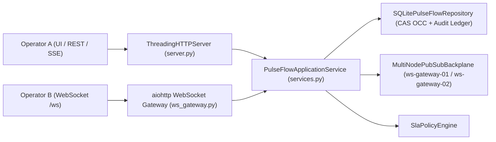

# Specification 03-Integration: Real-Time WebSocket, SSE & REST API Contracts

> **Repository**: `pulseflow-collab`
> **Layer**: Application & Interfaces (`src/application/`, `src/interfaces/http/`)
> **Author**: `integration-architect`
> **Status**: Approved for Implementation

---

## 1. Architectural Overview

The Integration layer connects the pure domain (`src/domain/`) and the atomic CAS + append-only audit persistence layer (`src/infrastructure/persistence/`) to external clients (the Incident Command War-Room UI, SRE automation scripts, and WebSocket/SSE consumers).



---

## 2. End-to-End DTO Schemas & Endpoint Contracts

All REST responses include:
- `Content-Type: application/json; charset=utf-8`
- `X-Content-Type-Options: nosniff`
- `Access-Control-Allow-Origin: *`
- `Access-Control-Allow-Methods: GET, POST, PATCH, OPTIONS`
- `Access-Control-Allow-Headers: Content-Type, Authorization, X-Actor, X-Gateway-Node`

### 2.1 `GET /api/v1/health`
Returns service readiness, active gateway nodes, incident count, and pub/sub backplane metrics.

**Response (`200 OK`)**:
```json
{
  "status": "ok",
  "service": "pulseflow-collab",
  "architecture": "modular-monolith-occ-pubsub",
  "gateway_nodes": ["ws-gateway-01", "ws-gateway-02"],
  "incident_count": 5,
  "active_presence_count": 3,
  "recent_events_count": 5
}
```

### 2.2 `GET /api/v1/incidents`
Lists all operational incidents enriched with deterministic SLA evaluation and timeline comment count.

**Response (`200 OK`)**:
```json
{
  "incidents": [
    {
      "incident_id": "INC-2026-101",
      "title": "Redis Pub/Sub Backplane Latency Spike",
      "service_name": "pulseflow-sync-backplane",
      "severity": "SEV1",
      "status": "INVESTIGATING",
      "commander": "sre.valeria",
      "summary": "P99 fan-out broadcast latency across WebSocket replica nodes exceeded 420ms...",
      "version": 1,
      "created_at": "2026-04-12T14:05:00+00:00",
      "updated_at": "2026-04-12T14:18:00+00:00",
      "comment_count": 2,
      "sla": {
        "incident_id": "INC-2026-101",
        "severity": "SEV1",
        "target_minutes": 15,
        "elapsed_minutes": 13.0,
        "remaining_minutes": 2.0,
        "breached": false
      }
    }
  ],
  "total": 5
}
```

### 2.3 `POST /api/v1/incidents`
Creates a new operational incident at `version=1`, appends `INCIDENT_CREATED` to the immutable audit ledger, and broadcasts `incident.created` across the multi-node backplane.

**Request Payload**:
```json
{
  "incident_id": "INC-2026-106",
  "title": "API Gateway TLS Handshake Timeout",
  "service_name": "edge-envoy-proxy",
  "severity": "SEV2",
  "status": "OPEN",
  "commander": "sre.daniela",
  "summary": "Elevated TLS handshake latency in eu-central-1 ingress tier.",
  "actor": "sre.daniela",
  "gateway_node": "ws-gateway-01"
}
```

**Response (`201 Created`)**:
```json
{
  "incident": { "...": "..." },
  "audit": {
    "audit_id": "AUD-...",
    "incident_id": "INC-2026-106",
    "version": 1,
    "actor": "sre.daniela",
    "action": "INCIDENT_CREATED",
    "changes": { "...": "..." },
    "changes_json": "{...}",
    "created_at": "2026-04-12T15:00:00+00:00"
  },
  "event": {
    "event_id": "evt-...",
    "channel": "incidents.realtime",
    "event_type": "incident.created",
    "incident_id": "INC-2026-106",
    "version": 1,
    "origin_node": "ws-gateway-01",
    "actor": "sre.daniela",
    "payload": { "...": "..." },
    "published_at": "2026-04-12T15:00:00+00:00"
  }
}
```

### 2.4 `GET /api/v1/incidents/{incident_id}`
Retrieves full tactical details for a single incident, including SLA evaluation, chronological timeline comments, active operator presence on that incident, and the immutable audit trail.

**Response (`200 OK`)**:
```json
{
  "incident": { "...": "..." },
  "sla": { "...": "..." },
  "comments": [
    {
      "comment_id": "CMT-2026-101-A",
      "incident_id": "INC-2026-101",
      "author": "sre.valeria",
      "body": "Identified slow consumer on ws-gateway-03...",
      "created_at": "2026-04-12T14:12:00+00:00"
    }
  ],
  "audit_trail": [
    {
      "audit_id": "AUD-...",
      "incident_id": "INC-2026-101",
      "version": 1,
      "actor": "sre.valeria",
      "action": "INCIDENT_CREATED",
      "changes": { "...": "..." },
      "changes_json": "{...}",
      "created_at": "2026-04-12T14:05:00+00:00"
    }
  ],
  "presence": []
}
```

### 2.5 `PATCH /api/v1/incidents/{incident_id}` (OCC Guarded State Mutation)
Applies a partial update (`title`, `severity`, `status`, `commander`, `summary`) guarded by Optimistic Concurrency Control (`expected_version`).

**Request Payload**:
```json
{
  "expected_version": 1,
  "actor": "sre.valeria",
  "gateway_node": "ws-gateway-01",
  "status": "MITIGATED",
  "summary": "Pub/Sub shard buffer limits tuned; p99 fan-out stabilized at 24ms."
}
```

**Success Response (`200 OK`)**:
- Persists `version = expected_version + 1` via atomic SQL CAS (`WHERE incident_id = ? AND version = ?`).
- Appends `STATUS_TRANSITION` or `INCIDENT_UPDATED` to `incident_audit_ledger`.
- Publishes `incident.updated` to `MultiNodePubSubBackplane` (fanned out to `ws-gateway-01` and `ws-gateway-02`).
- Updates operator presence to `observed_version = new_version`.
- Returns `{ "incident": ..., "audit": ..., "event": ... }`.

**Conflict Response (`409 Conflict`)**:
- When `expected_version != actual_version`:
  - Publishes `incident.conflict_rejected` to `MultiNodePubSubBackplane` with `{ "expected_version": <int>, "actual_version": <int>, "actor": "<str>" }`.
  - Returns HTTP `409 Conflict`:
```json
{
  "error": {
    "code": "ERR-409-OPTIMISTIC-LOCK",
    "message": "[ERR-409-OPTIMISTIC-LOCK] Optimistic concurrency conflict for incident 'INC-2026-101': expected version 1, actual version 2.",
    "incident_id": "INC-2026-101",
    "expected_version": 1,
    "actual_version": 2
  }
}
```

### 2.6 `POST /api/v1/incidents/{incident_id}/comments`
Appends an immutable tactical note to the incident timeline and audit ledger, and broadcasts `comment.added` across the pub/sub backplane.

**Request Payload**:
```json
{
  "author": "netops.carlos",
  "body": "Confirmed zero packet drops across ws-gateway-01 and ws-gateway-02.",
  "gateway_node": "ws-gateway-02"
}
```

**Response (`201 Created`)**:
```json
{
  "comment": {
    "comment_id": "CMT-...",
    "incident_id": "INC-2026-101",
    "author": "netops.carlos",
    "body": "Confirmed zero packet drops across ws-gateway-01 and ws-gateway-02.",
    "created_at": "2026-04-12T14:30:00+00:00"
  },
  "audit": { "...": "..." },
  "event": { "...": "..." }
}
```

### 2.7 `GET /api/v1/presence` & `POST /api/v1/presence`
Tracks active operators per WebSocket gateway node (`ws-gateway-01`, `ws-gateway-02`) and their observed aggregate version.

**POST Request Payload**:
```json
{
  "operator_id": "sre.daniela",
  "gateway_node": "ws-gateway-02",
  "active_incident_id": "INC-2026-101",
  "observed_version": 2
}
```

### 2.8 `GET /api/v1/events/backplane`
Returns recent `RealtimeEnvelope` events fanned out across the multi-node pub/sub backplane along with per-gateway delivery telemetry.

**Response (`200 OK`)**:
```json
{
  "nodes": ["ws-gateway-01", "ws-gateway-02"],
  "node_delivery_counts": {
    "ws-gateway-01": 12,
    "ws-gateway-02": 12
  },
  "events": [
    {
      "event_id": "evt-...",
      "channel": "incidents.realtime",
      "event_type": "incident.updated",
      "incident_id": "INC-2026-101",
      "version": 2,
      "origin_node": "ws-gateway-01",
      "actor": "sre.valeria",
      "payload": { "...": "..." },
      "published_at": "2026-04-12T14:20:00+00:00"
    }
  ]
}
```

### 2.9 `GET /api/v1/events/stream` (Server-Sent Events)
Streams real-time `RealtimeEnvelope` events using `Content-Type: text/event-stream`. Supports both continuous streaming and bounded snapshot delivery (`?once=1` for deterministic integration tests).

### 2.10 `GET /api/v1/audit/ledger`
Returns immutable append-only audit records (`?incident_id=INC-2026-101&limit=100`).

### 2.11 `GET /ws` (RFC 6455 Full-Duplex WebSocket Gateway)
Provided by `src/interfaces/http/ws_gateway.py` (`create_aiohttp_ws_app`).
- Accepts query parameters `?node=ws-gateway-01&operator=sre.daniela&incident_id=INC-2026-101`.
- Registers operator presence and subscribes the WebSocket session to the designated gateway node on `MultiNodePubSubBackplane`.
- Supports inbound JSON commands (`ping`, `presence.update`, `incident.patch`, `comment.add`) and pushes outbound `RealtimeEnvelope` packets in real time.

---

## 3. Semantic HTTP Error Mapping & Zero Stack-Trace Policy

| Domain / Protocol Exception | HTTP Status | Error Code | Response Shape |
| :--- | :--- | :--- | :--- |
| `InvalidIncidentError` / Malformed JSON / Oversized Body (`> 64 KB`) | `400 Bad Request` | `ERR-400-BAD-REQUEST` | `{"error": {"code": "ERR-400-BAD-REQUEST", "message": "..."}}` |
| `IncidentNotFoundError` / Unknown Route | `404 Not Found` | `ERR-404-INCIDENT-NOT-FOUND` / `ERR-404-NOT-FOUND` | `{"error": {"code": "...", "message": "..."}}` |
| `OptimisticConcurrencyError` | `409 Conflict` | `ERR-409-OPTIMISTIC-LOCK` | `{"error": {"code": "ERR-409-OPTIMISTIC-LOCK", "message": "...", "incident_id": "...", "expected_version": 1, "actual_version": 2}}` |
| `InvalidStateTransitionError` | `422 Unprocessable Entity` | `ERR-422-INVALID-TRANSITION` | `{"error": {"code": "ERR-422-INVALID-TRANSITION", "message": "..."}}` |
| Unhandled `Exception` | `500 Internal Server Error` | `ERR-500-INTERNAL` | `{"error": {"code": "ERR-500-INTERNAL", "message": "An unexpected internal server error occurred."}}` |

**Security & Boundary Rules**:
1. Request payloads exceeding `MAX_JSON_BODY_BYTES = 64 * 1024` (`64 KB`) are rejected before parsing with `400 Bad Request`.
2. Internal Python tracebacks, SQL queries, or file paths are **never** serialized in HTTP or WebSocket error responses.
