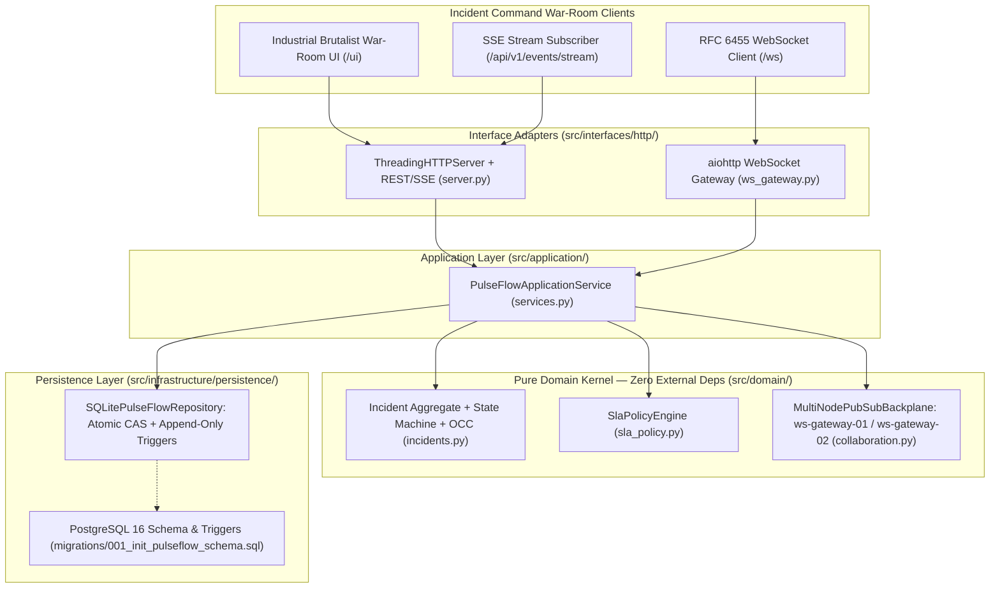

# PulseFlow Collab — Real-Time Collaborative Incident Command & Operational Sync Engine

> **Architecture**: Modular Monolith · Clean Architecture & DDD · Optimistic Concurrency Control (CAS OCC) · Multi-Node WebSocket / Redis Pub-Sub Backplane · Database-Enforced Append-Only Audit Ledger

**PulseFlow Collab** is a mission-critical collaborative incident command engine and operational war-room console designed for Site Reliability Engineering (SRE) teams. It coordinates high-severity incident response (`SEV1`–`SEV4`), enforces strict lifecycle state machines, prevents concurrent "Lost Updates" via **Optimistic Concurrency Control (`ERR-409-OPTIMISTIC-LOCK`)**, evaluates real-time SLA burn rates, records immutable forensic audit trails, and fans out real-time events across distributed WebSocket/SSE gateway nodes (`ws-gateway-01`, `ws-gateway-02`).

---

## 1. System Architecture



---

## 2. Key Engineering Capabilities

1. **Optimistic Concurrency Control (Atomic CAS & `409 Conflict`)**:
   - Every `Incident` aggregate carries a monotonically increasing `version` (`>= 1`).
   - Concurrent updates must supply `expected_version`. Stale writes are deterministically rejected at both the domain layer and SQL Compare-And-Swap (`WHERE incident_id = ? AND version = ?`), broadcasting an `incident.conflict_rejected` event and returning HTTP `409 Conflict` with `ERR-409-OPTIMISTIC-LOCK`.
2. **Deterministic Incident Lifecycle State Machine**:
   - Enforces valid transitions across `OPEN`, `INVESTIGATING`, `MITIGATED`, and `RESOLVED` (`RESOLVED` incidents can only reopen via `INVESTIGATING`). Invalid transitions return HTTP `422 Unprocessable Entity`.
3. **Multi-Node WebSocket / Pub-Sub Backplane (`ws-gateway-01`, `ws-gateway-02`)**:
   - Broadcasts immutable `RealtimeEnvelope` packets across all gateway nodes and tracks live operator presence (`PresenceSession`) per gateway node.
4. **Database-Enforced Append-Only Audit Ledger**:
   - Every incident creation, field mutation, status transition, and timeline comment is atomically recorded in `incident_audit_ledger`.
   - `BEFORE UPDATE` and `BEFORE DELETE` SQL triggers block any modification or deletion of historical audit rows (`APPEND_ONLY_LEDGER_VIOLATION`).
5. **Severity-Driven SLA Policy Engine**:
   - Computes target budgets (`SEV1: 15m`, `SEV2: 60m`, `SEV3: 240m`, `SEV4: 1440m`), remaining minutes, and breach states in real time.

---

## 3. API Endpoints & Protocol Contracts

| Method | Path | Success Status | Description |
| :--- | :--- | :--- | :--- |
| `GET` | `/` or `/ui` | `200 OK` | Serves the Interactive Incident Command War-Room Console (`ui/index.html`). |
| `GET` | `/api/v1/health` | `200 OK` | Service readiness, registered gateway nodes, incident & presence counts. |
| `GET` | `/api/v1/incidents` | `200 OK` | List all incidents enriched with SLA evaluation and comment counts. |
| `POST` | `/api/v1/incidents` | `201 Created` | Create a new `version=1` incident, append audit entry, and publish `incident.created`. |
| `GET` | `/api/v1/incidents/{id}` | `200 OK` | Full incident tactical detail (aggregate, SLA, comments, audit trail, presence). |
| `PATCH` | `/api/v1/incidents/{id}` | `200 OK` / `409 Conflict` | OCC-guarded state update (`expected_version`, `actor`). Broadcasts `incident.updated` or `incident.conflict_rejected`. |
| `POST` | `/api/v1/incidents/{id}/comments` | `201 Created` | Append immutable timeline comment + audit record and broadcast `comment.added`. |
| `GET` | `/api/v1/presence` | `200 OK` | List active operator presence sessions across gateway nodes. |
| `POST` | `/api/v1/presence` | `200 OK` | Upsert operator presence session on a gateway node (`ws-gateway-01` / `ws-gateway-02`). |
| `GET` | `/api/v1/events/backplane` | `200 OK` | Inspect recent `RealtimeEnvelope` packets and per-gateway delivery counts. |
| `GET` | `/api/v1/events/stream` | `200 OK` | Server-Sent Events (`text/event-stream`) real-time backplane stream. |
| `GET` | `/api/v1/audit/ledger` | `200 OK` | Query immutable append-only audit ledger entries (`?incident_id=...&limit=100`). |
| `GET` | `/ws` | `101 Switching Protocols` | Full-duplex RFC 6455 WebSocket gateway (`ws_gateway.py`). |

### Semantic Error Mapping (Zero Stack-Trace Leakage)

| Domain Exception | HTTP Status | Error Code |
| :--- | :--- | :--- |
| `InvalidIncidentError` / Malformed JSON / `> 64 KB` body | `400 Bad Request` | `ERR-400-BAD-REQUEST` |
| `IncidentNotFoundError` | `404 Not Found` | `ERR-404-INCIDENT-NOT-FOUND` |
| `OptimisticConcurrencyError` | `409 Conflict` | `ERR-409-OPTIMISTIC-LOCK` |
| `InvalidStateTransitionError` | `422 Unprocessable Entity` | `ERR-422-INVALID-TRANSITION` |

---

## 4. Quick Start (1-Command Local Startup)

### Option A: Zero-Dependency Python 3.12 Runtime
```bash
python -m src.interfaces.http.server
```
Then open **`http://127.0.0.1:8095`** in your browser to launch the Incident Command War-Room Console, or query **`http://127.0.0.1:8095/api/v1/incidents`**.

### Option B: Docker Compose (Multi-Stage Container + Redis Pub/Sub Backplane)
```bash
docker compose up --build
```

### Running the Automated Test Suite
```bash
python -m unittest discover -s tests -v
```

---

## 5. Architecture Decision Records & Specifications

- [`.specs/01-domain/modular-monolith-incidents-and-collab.spec.md`](.specs/01-domain/modular-monolith-incidents-and-collab.spec.md)
- [`.specs/02-data/optimistic-lock-store-and-audit-ledger.spec.md`](.specs/02-data/optimistic-lock-store-and-audit-ledger.spec.md)
- [`.specs/03-integration/realtime-ws-rest-contracts.spec.md`](.specs/03-integration/realtime-ws-rest-contracts.spec.md)
- [`docs/adr/001-modular-monolith-and-redis-pubsub-backplane.md`](docs/adr/001-modular-monolith-and-redis-pubsub-backplane.md)
- [`docs/adr/002-optimistic-concurrency-and-append-only-audit-ledger.md`](docs/adr/002-optimistic-concurrency-and-append-only-audit-ledger.md)
